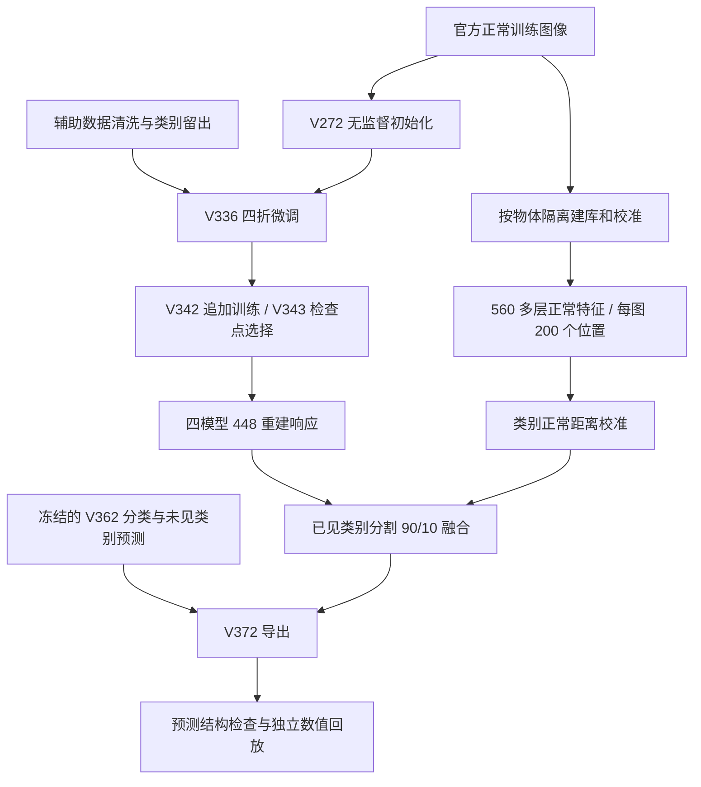

# CSIG Multi-View Anomaly Detection · V372

复杂工业场景下的五视角异常检测研究代码，基于 Dinomaly2 与 DINOv3，包含训练、正常特征记忆、校准、融合推理和审计流程。

**代码版本：V372。**

This repository archives a five-view industrial anomaly detection pipeline built on Dinomaly2 and DINOv3. It is a research release, with CPU contract tests and source provenance; full inference requires external data, checkpoints, and historical calibration artifacts.

## 方法

模型对物体的五个视角分别提取异常证据，再汇总物体级分数。已见类别的分割结合重建异常响应与正常特征近邻距离。



| 参数 | V372 设置 |
| --- | --- |
| 主干 | DINOv3 ViT-Base/16 |
| 重建网络 | Dinomaly2；448×448 输入；四检查点响应中位数 |
| 正常记忆输入 | 560×560 |
| 特征层 | 3、7、11；拼接维数 2304；35×35 网格 |
| 建库采样 | 每图原 50 个位置 + 150 个不重复位置 |
| 已见类别正常划分 | 每类 16 个五视角物体建库、4 个物体校准；seed=34801 |
| 每类正常特征数 | 80 张图 × 200 = 16000 行 |
| 分割融合 | 0.9 × 重建响应 + 0.1 × 校准后的记忆距离 |
| 重建参考 q99 | 0.04275937380269168 |
| 分类 | 单视角最高 0.5% 响应均值；五视角取最高两个均值；使用原分数映射 |
| 输出掩码 | 448×448、单通道灰度 PNG |

V372 的分类 CSV 和 5000 张未见类别掩码沿用 V362；V372 只更新 6250 张已见类别掩码。
**V372 本身没有新增梯度训练**，使用前面训练并选出的四个检查点扩充正常特征库。
四折最终选择分别为 4000、1000、6000、1000 微调步；这些步数不包括 V272 的 100000 步初始化训练。

## 代码导航

| 文件 | 用途 |
| --- | --- |
| `scripts/v272_dinomaly2_dinov3_i448_ddp.py` | 官方正常集上的四卡初始化训练 |
| `scripts/v335_clean_data.py` | 辅助数据清洗、重叠排除、类别划分 |
| `scripts/v336_clean_train.py` | 四折微调 |
| `scripts/v342_clean_longtrain.py` | 追加训练 |
| `scripts/v343_longrun_selection.py` | 独立回放与检查点选择 |
| `scripts/v349_clean_memory_bank.py` | 正常特征库 |
| `scripts/v355_seen_category_calibration.py` | 正常类别校准 |
| `scripts/v372_dense_inference.py` | V372 密集记忆与融合推理 |
| `scripts/v372_dense_export.py` | 预测压缩包导出 |
| `scripts/v372_numerical_audit.py` | 独立数值审计 |

历史版本号用于追踪依赖，不表示每个历史分支都是当前推荐方案。

## 先运行 CPU 测试

推荐 Python 3.10。在独立虚拟环境中安装 CPU 测试依赖：

```bash
python -m pip install torch==2.3.1 --index-url https://download.pytorch.org/whl/cpu
python -m pip install -r requirements-test.txt
python -m pytest -q tests/test_v372_dense_export.py tests/test_v372_dense_inference.py tests/test_v372_numerical_audit.py
python tools/verify_release.py
```

这些测试使用合成数据验证形状、采样、融合、导出和数值审计约束，不使用比赛数据，不衡量线上准确率。
公开版整理时会重新运行，结果记录在 `docs/VERIFICATION.json`。

## GPU 环境与复现

原环境：4×Tesla P100 16GB，Python 3.10.12，PyTorch 2.3.1+cu118，torchvision 0.18.1+cu118，NumPy 1.24.3，Pillow 9.5.0。
完整环境版本记录见 `configs/original_environment.json`；CPU 测试依赖不是完整训练环境锁定文件。

模型实现从 [Dinomaly2 官方仓库](https://github.com/guojiajeremy/Dinomaly2) 单独获取。原服务器记录的提交为 `1745c613a7079117798fdba42c6664d9f45820ce`；逐文件来源哈希见 `configs/source_provenance.json`。
本仓库不复制第三方模型源码或权重。原代码还需要 DINOv3 基础权重；来源和使用条件请查阅 [DINOv3 官方仓库](https://github.com/facebookresearch/dinov3)。

将第三方代码放到工作目录下的 `Dinomaly2_dinov3/`，按其官方说明准备依赖后设置：

```bash
export PYTHONPATH="$PWD/Dinomaly2_dinov3:$PWD:$PWD/scripts"
```

完整复现还需要：官方数据集、已授权辅助数据、教师缓存、V272 初始化检查点、四个选中的微调检查点、正常记忆二进制、历史验证与校准记录，以及 V362 基线预测。
检查点身份见 `configs/selected_checkpoints.json`；外部文件路径与校验值见 `configs/external_artifacts.json`。仓库不分发这些文件或比赛测试标签。

**这是经过隐私清理的研究代码归档，不是一键复现包。** 原脚本保留冻结文件和哈希校验；公开版将原专用服务器根目录改成了 `Path.home() / 'csig'`，因此部分源码哈希与历史报告不同。
重跑需要重建来源记录或使用作者留存的原始环境，不能直接跳过校验。详见 [发布说明](docs/PUBLICATION_NOTES.md)。本次发布未重新训练 GPU 模型、未重新生成 B 榜预测。

## 局限与数据边界

- 辅助数据按类别留出，训练清洗排除目标类别及已知精确重叠物体；这不能排除所有语义相关或近重复关系。
- 正常建库与校准按物体隔离；原生产校准分区保留已知空白重复物体，不作为独立质量验证集。
- 合成数据测试用于检查实现约束，不替代独立的真实场景质量评估。
- 图像、数据标签、模型权重、预测结果和服务器运行日志均不在公开内容中。

## 致谢与使用条件

核心模型建立在 [Dinomaly2](https://github.com/guojiajeremy/Dinomaly2) 与 [DINOv3](https://github.com/facebookresearch/dinov3) 上。请在使用或介绍本工作时保留这些来源。
维护者的贡献主要是五视角比赛数据适配、类别隔离训练与选择、正常记忆扩充、校准、融合和审计；不将第三方模型架构归为原创。

本次整理未为整个仓库另行指定统一开源许可证。公开可读不等于已授予任意复制、修改或再分发许可；第三方依赖和数据分别遵循其原始条款。
